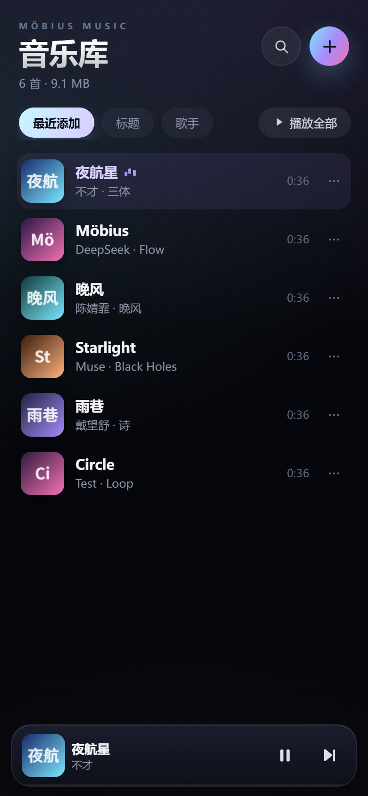

# Möbius Music · 莫比乌斯音乐

一个**装在 iPhone 主屏幕上、离线可用、无需登录**的本地音乐播放器。

把音乐放进 iPhone 的「文件」App，导入本应用，就能得到播放列表、封面、锁屏控制和断网播放——所有数据只存在手机本地。




> 截图为验收用的示例音轨（音频与封面均为程序生成的测试数据）。

---

## 先说明一个 iOS 限制

iPhone 不允许网页/第三方应用**自动扫描任意文件夹**，而编译原生 iOS App 需要 macOS + Xcode + 签名，当前环境无法完成。因此本项目采用 **PWA**：

- 用 Safari 打开 → 「添加到主屏幕」→ 全屏运行，体验接近原生 App；
- 音乐通过 iOS 的**文件选择器**导入，导入后复制到应用本地存储（IndexedDB），之后断网、锁屏都能播放；
- 不登录、不联网、不上传，没有后端。

要让**界面本身**也离线（电脑关机也能打开），需要 HTTPS 托管一次（Service Worker 在 HTTP 局域网下不被 Safari 允许）。下面给了两种方式。

---

## 两种使用方式

### 方式 A：局域网先用起来（最快）

1. 双击 `start.cmd`（或命令行 `node server.js`）。
2. 电脑和 iPhone 连接**同一个 Wi-Fi**。
3. 控制台会打印类似：
   ```
   本机预览   http://localhost:8090
   iPhone     http://192.168.1.8:8090
   ```
4. iPhone Safari 打开那个 `192.168…` 地址。
5. 点 Safari 分享按钮 →「添加到主屏幕」。
6. 打开桌面上的图标 → 右上角 ＋ → 导入音乐。

> 这种方式电脑需要开着：手机上的**音乐数据**存在本地，但页面外壳由电脑提供。适合先试用。

### 方式 B：部署到 HTTPS（推荐，真正的离线单机版）

把整个文件夹上传到任意静态托管，**不需要构建、不需要后端**：

- GitHub Pages（免费）
- Netlify / Vercel（拖拽上传）
- 自己的 NAS / 服务器（需 HTTPS）

GitHub Pages 步骤：

1. 新建一个仓库，把本目录的全部文件上传（`index.html` 放在仓库根目录）。
2. 仓库 Settings → Pages → Source 选 `Deploy from a branch` → `main` / `root`。
3. 等待 1 分钟，用 iPhone 打开 `https://<你的用户名>.github.io/<仓库名>/`。
4. Safari 分享 →「添加到主屏幕」。
5. 首次打开后 Service Worker 会缓存界面；之后**完全离线**，电脑关机也能用。

> 首次打开需要联网加载一次；之后断网、飞行模式都能打开并播放已导入的歌。

### 方式 C：原生 App

如果你有 Mac + Xcode，可以另做一份 SwiftUI 原生工程（`UIDocumentPicker` 选目录 + `AVAudioPlayer`），但无法在当前 Windows 环境编译/签名，所以本次交付可运行的是 PWA。

---

## 把音乐放进 iPhone

1. 用电脑 / AirDrop / iCloud Drive，把歌曲放进「文件」App：
   「我的 iPhone」→ 新建一个 `Music` 文件夹 → 把 MP3/M4A 等拷进去。
2. 回到本应用，点右上角 **＋** →「从「文件」选择音乐」。
3. 在文件选择器里进入 `Music`，点右上角「选择」→ 全选（或逐个勾选）→「打开」。
4. 等待导入完成（会读取标题、歌手、封面、时长）。

> **导入 = 复制进应用本地存储**。导入后可以把「文件」里的原文件删掉，应用仍能播放。
> 支持 MP3 / M4A / AAC / WAV / FLAC / OGG / OPUS。DRM 保护的音频（Apple Music 下载、部分 `.m4p`）无法播放。

---

## 功能

- **音乐库**：封面缩略图、标题、歌手/专辑、时长
- **播放列表**：最近添加 / 标题 / 歌手排序，搜索，播放全部
- **批量导入**：多选/整个文件夹，进度显示、取消、重复跳过、超大文件跳过
- **播放器**：上一首 / 下一首、随机播放、列表循环 / 单曲循环、拖动进度
- **迷你播放器**：列表底部常驻，点开进入全屏播放页
- **播放队列**：查看并按顺序跳转
- **锁屏 / 控制中心**：Media Session 元数据与播放控制
- **标签解析**：ID3v2.3 / v2.4（MP3）、iTunes `ilst`（M4A）、WAV / FLAC 头；无标签时回退文件名
- **完全本地**：无账号、无埋点、无外部请求（CSP 限制为 self）
- **离线**：音频与封面存 IndexedDB；HTTPS 部署后界面也可离线

---

## 使用小贴士

- 列表右侧「…」：立即播放 / 加入队列 / 文件信息 / 从本机删除。
- 顶部搜索图标：按标题、歌手、专辑、文件名搜索。
- 桌面浏览器（Chrome/Edge）支持「选择整个文件夹」批量导入；iOS 只支持多选文件。
- 键盘：空格播放/暂停，`←` / `→` 上一首/下一首，`Esc` 关闭。
- 播放进度与上次歌曲会自动记住（刷新/下次打开恢复）。

---

## 数据与隐私

- 音频、封面、播放进度全部保存在**这台 iPhone 的浏览器本地存储**（IndexedDB / localStorage）。
- 没有登录、没有服务器、没有统计代码；CSP 禁止加载任何外部资源。
- **删除主屏幕图标会清空该应用的全部数据**（iOS 的行为）。删除单曲请用「…」菜单。
- 存储空间取决于 iPhone 剩余空间与 Safari 配额；顶部会显示已导入的总大小。

---

## 已知限制

| 限制 | 说明 |
| --- | --- |
| 不能自动扫描目录 | iOS 沙箱限制，只能通过文件选择器导入 |
| HTTP 下无 Service Worker | 局域网模式电脑关机后无法打开页面；HTTPS 部署后才行 |
| 背景播放 | 依赖 iOS 的 Media Session；个别系统版本锁屏后可能暂停 |
| DRM 音频 | Apple Music 等受保护文件无法播放 |
| 曲库上限 | 受 Safari 存储配额限制（通常数百 MB 到数 GB，视系统而定） |

---

## 目录结构

```
mobius-music/
├─ index.html            界面结构
├─ styles.css            iOS 风格样式（安全区、深色、毛玻璃）
├─ app.js                播放列表、播放控制、导入、锁屏、菜单
├─ db.js                 IndexedDB：元数据 / 音频 / 封面 三张表
├─ id3.js                ID3v2 与 MP4 标签 / 封面解析
├─ sw.js                 Service Worker（应用外壳离线）
├─ manifest.webmanifest  PWA 清单
├─ icons/icon.svg        应用图标
├─ server.js             零依赖局域网静态服务器
├─ start.cmd             双击启动（Windows）
├─ build/                验收截图（示例数据）
└─ README.md
```

---

## 技术备注

- **导入**：`File` → 解析标签 → 生成 96px 封面缩略图 → 音频 Blob 与封面 Blob 分表存入 IndexedDB；元数据表不含音频，启动时只读元数据，速度快、内存小。
- **播放**：单个 `<audio>` + `URL.createObjectURL(blob)`；iOS 首次触摸用静音 WAV 解锁音频元素，之后可连续播放。
- **标签**：ID3v2.3 使用普通 32 位帧长，v2.4 使用 syncsafe；MP4 在文件头/尾 2MB 内定位 `moov`（含签名扫描）后读取 `ilst`。
- **离线**：Service Worker 对导航请求网络优先、失败回退缓存；静态资源缓存优先并后台更新。
- **安全**：CSP `default-src 'self'`；无内联脚本；所有文件名在插入 DOM 前转义。

---

## 常见问题

**1. 手机打不开地址**

- 确认手机和电脑在同一个 Wi-Fi（不是 5G）。
- Windows 首次运行会弹防火墙授权，选“允许访问”。
- 电脑有多个网卡时控制台会打印多个 IP，选 Wi-Fi 那个（通常 `192.168.x.x`）。
- 用 `ipconfig` 查看电脑的 IPv4 地址。

**2. 导入时看不到音乐文件**

- 确认文件扩展名是音频格式；iCloud 里的文件可能需要先「下载」到本机。
- 文件选择器右上角切到「浏览」→「我的 iPhone」→ 对应文件夹。

**3. 列表里有歌但点播放没声音**

- 检查 iPhone 静音开关/音量；iOS 的媒体音量由侧边键控制。
- 若是 DRM 文件或损坏文件，会提示“无法播放”。
- 首次播放如果被系统拦截，点一下播放按钮（用户手势）即可。

**4. 批量导入很久 / 像卡住了**

- 导入阶段**不会逐首等待音频时长**：时长优先从 MP3 TLEN、M4A `mvhd`、WAV/FLAC 头直接计算；算不出的先显示 `--:--`，导入结束再用一个复用的 audio 元素在后台补齐（每首最多 2.5 秒，连续失败 8 次会自动停止）。
- 每个文件都有超时（标签 10s / 封面 8s / 入库 20s），单个坏文件不会卡住整个队列。
- 进度弹窗上有「取消导入」，已完成的歌会保留。
- 如果仍然很慢，通常是这些原因：iCloud 里的文件尚未下载到本机、单曲超过 200MB 被跳过、iPhone 存储空间不足（会提示配额错误）。
- 实测（桌面 Chrome，20 个 WAV）：约 1 秒完成导入。

**4.1 导入报 `timeout:db` / `timeout:db-retry`**

**先确认没有使用 Safari 无痕模式**：无痕窗口会限制甚至清空 IndexedDB，表现为导入一直超时；关掉无痕再试。

这是 Safari 的 IndexedDB 写入卡住了。新版已经改成**分片存储**：

- 音频按 **2MB 分片**写入，每片一个独立事务、失败自动重试，播放时再拼回完整 Blob —— 不再依赖"一次写入几十 MB 大 Blob"；
- 超时后**主动 abort 事务并重建连接**；
- 音频与封面拆成两个事务，封面写失败不影响歌曲入库；
- 导入时暂停后台缓存预热。

如果仍然出现该错误：打开「＋ → 导入说明 → **存储自检**」，它会写入一个完整的 2MB 分片并读回：

- 显示"存储写入正常"→ 说明存储可用，把失败文件名/大小发我；
- 显示"存储异常"→ 是这台 iPhone 的 Safari 存储被限制（无痕模式、存储空间不足、Lockdown Mode 等），换普通模式/清理空间后再试；
- 也可以在"导入结果"面板点 **「重置本地数据库」**（会清空已导入歌曲）。

**4.2 导入后歌名 / 歌手乱码**

中文 MP3 很常见：ID3 标记声明编码是 ISO-8859-1，实际字节却是 GBK，按 Latin-1 解出来就是 `Ò¹º½ÐÇ` 这种。

- 新版导入会**自动识别并修复**（GBK / Big5，含 Windows-1252 变体；`Beyoncé` 这类正常拉丁文不会被误伤）；
- 已经导入的歌：点右上角 **＋** →「修复所有乱码名称」批量修复；或单曲右侧 **…** →「修复乱码名称」；
- 单字标题（只有 1 个汉字）可能因样本太少不触发自动修复，可手动改文件名后重新导入。

**5. 重启手机 / 关掉应用后歌还在吗？**

在。数据存在 IndexedDB。除非删除主屏幕图标或清除 Safari 网站数据。

**6. 电脑关机后还能用吗？**

- 用方式 B（HTTPS 部署）可以。
- 用方式 A（局域网）不行，因为没有 Service Worker，页面外壳仍由电脑提供。

**7. 想更新应用**

替换文件后，把 `sw.js` 里的 `CACHE = 'mobius-music-v5'` 改成 `v6`，重新部署；手机打开一次即可更新缓存。

---

## 许可

MIT
